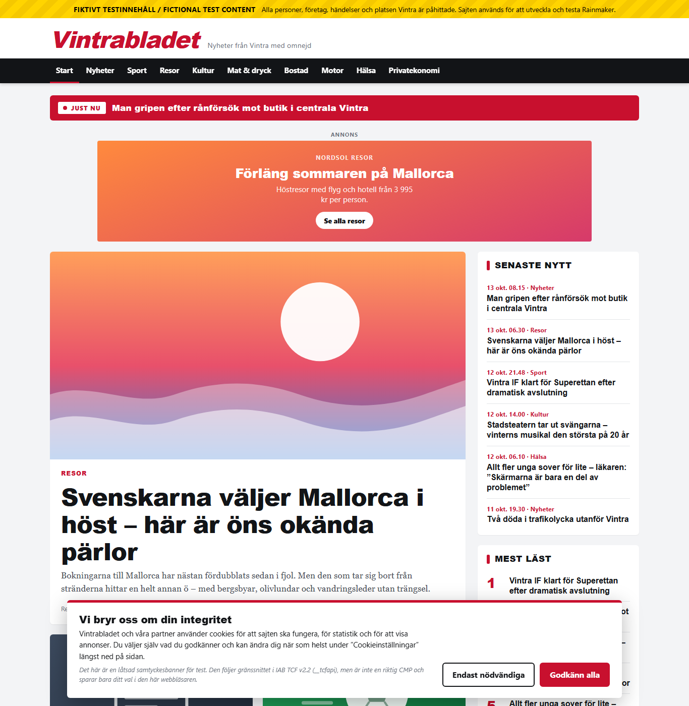
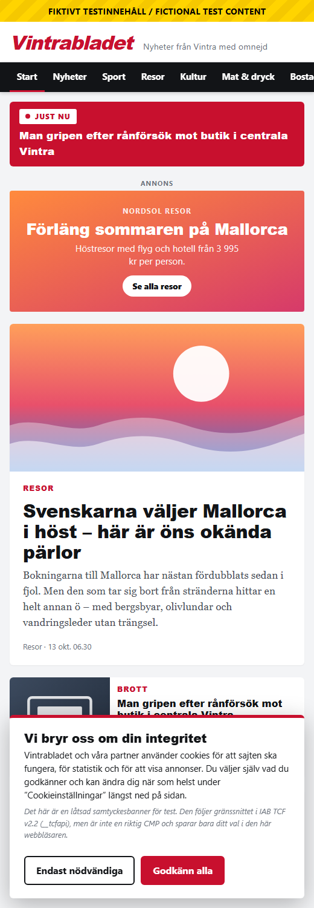

# Vintrabladet – Rainmaker test publisher site

A **completely fictional** Swedish news site that behaves like a real
publisher's site, so Rainmaker can be developed, tested and demonstrated
without real or copyrighted content (Solution Architecture v0.5, section 7.5;
Getting Started Guide, section 5.1).

Built with the project stack: **Java 21, Spring Boot 4.1 and Maven**
(server-rendered HTML with Thymeleaf). It is a module of the Rainmaker
repository, `apps/test-site/`, built by the root `pom.xml` like every other
Java module (Getting Started Guide, section 4.2).

The newspaper *Vintrabladet*, the town of *Vintra* and every person, company
and advertiser on the site are made up. Every page carries a
**"Fiktivt testinnehåll / Fictional test content"** banner.

| Desktop | Mobile |
|---|---|
|  |  |

<details>
<summary>PLUS article with in-article ad and paywall</summary>


</details>

## Why it is built this way

Rainmaker's widget has to work on *real* news sites – and real news sites are
messy. A clean demo page hides exactly the problems that would show up at the
pilot publisher. So besides articles, RSS and a sitemap, Vintrabladet has the
third-party parts almost every Swedish news site has:

| Real-world part | On Vintrabladet | What it lets us test (architecture ref.) |
|---|---|---|
| Consent banner (CMP) | Fake CMP with the real IAB TCF v2.2 `__tcfapi` interface, incl. the early "stub" | Widget respects reader consent (A1, US-12, P7) |
| Ad server | Ads that arrive 0.3–1.5 s after the page; one in-article slot reserves no space and pushes the text down | No layout shift from the panel (CLS = 0), no clashes with ad code (A1) |
| Google Tag Manager | Small GTM-like tag manager with a container and a consent-gated tag | Installing rainmaker.js through a tag manager (P4) |
| Strict Content-Security-Policy | Only the site's own files + the widget's origin may load | Which domains the widget needs allow-listed (P5) |
| Sticky header | The menu sticks to the top while scrolling | The panel is not hidden under it |
| Paywall | Three PLUS articles with a fading text and an offer box | Ingestion still gets the full text; panel placement around overlays |
| Editorial front page | Lead story, "JUST NU" bar and "Mest läst" chosen in a file, not by date | Demos that look like a real front page |

## Quick start

Two ways to run it. Both start the site on **http://localhost:3000**.

**With Docker** (needs only Docker, no Java). From this folder:

```
docker compose up --build      # stop with Ctrl+C, then: docker compose down
```

**With Java** (JDK 21 or newer; Maven is downloaded by the wrapper). From the
**repository root**:

```powershell
.\mvnw.cmd -pl apps/test-site spring-boot:run     # Windows (PowerShell / cmd)
./mvnw -pl apps/test-site spring-boot:run         # macOS, Linux, Git Bash
```

Stop with `Ctrl+C`. The first start takes a minute (downloads); after that a
few seconds.

All Maven commands run from the repository root; `-pl apps/test-site` limits
them to this module.

| Command | What it does |
|---|---|
| `./mvnw -pl apps/test-site spring-boot:run` | Start the site |
| `./mvnw -pl apps/test-site test` | Run the Java tests (~180, JUnit 5 + AssertJ + MockMvc) |
| `./mvnw -pl apps/test-site verify` | Everything CI runs: tests + formatting check + Checkstyle + coverage report |
| `./mvnw -pl apps/test-site spotless:apply` | Format the Java code (google-java-format) |
| `npm test` (in `apps/test-site/`) | Tests for the browser JavaScript (needs Node.js 22.18+) |

CI runs the same checks on every pull request that changes this folder
(`.github/workflows/test-site-ci.yml`).

The terminal shows one JSON log line per event (ECS format, with `trace_id`
and `correlation_id`) – that is the project's logging standard, not an error.

After editing a template, CSS, JavaScript or content file, restart the site
to see the change.

### Things to try in the browser

1. **Consent:** the banner appears on the first visit. Click *Godkänn alla*,
   then open the developer tools (F12) → Console and type `dataLayer`: you see
   `consent_update` and the `page_view` from the statistics tag, which only
   loads after consent. *Cookieinställningar* in the footer reopens the banner.
   To start over, clear the site data (F12 → Application → Clear storage).
2. **Ask for consent like a widget would:** in the console, type
   `__tcfapi('addEventListener', 2, (data) => console.log(data))`.
3. **Ads:** reload an article and watch the ad inside the text appear late
   and push the text down.
4. **Paywall:** open a PLUS article (e.g. the electric car test) and click
   *Fortsätt läsa (testläge)*.
5. **Sticky menu:** scroll down – the menu stays and gets a small logo.

### Trying a widget installation

`static/js/widget-stub.js` is a stand-in for rainmaker.js. It shows no panel
but checks the integration: it loads, finds the headline and reads consent.

```powershell
# 1. Directly in the page template (the default method)
$env:RAINMAKER_SCRIPT_URL = 'http://localhost:3000/static/js/widget-stub.js'
.\mvnw.cmd -pl apps/test-site spring-boot:run

# 2. Through the tag manager instead
$env:RAINMAKER_INSTALL_METHOD = 'tag-manager'
.\mvnw.cmd -pl apps/test-site spring-boot:run
```

With Docker, put the same variables in a `.env` file next to
`docker-compose.yml` (git-ignored) and run `docker compose up --build`.

Open an article and look in the browser console for `[rainmaker stub]`.
Remove the variables afterwards with
`Remove-Item Env:RAINMAKER_SCRIPT_URL, Env:RAINMAKER_INSTALL_METHOD`.

## What is on the site

| Address | What it is | Who uses it |
|---|---|---|
| `/` | Front page: "JUST NU", top stories, latest, most read, ads | Readers, demos |
| `/artikel/<slug>` | One article (PLUS articles have a paywall) | Readers, widget (S1), ingestion (S5) |
| `/sektion/<id>` | All articles in a section, e.g. `/sektion/sport` | Readers |
| `/rss.xml` | RSS 2.0 feed with every article | Content Ingestion (S5) |
| `/sitemap.xml` | Google News-style sitemap | Content Ingestion (S5) |
| `/robots.txt` | Points crawlers to the sitemap | Crawlers |
| `/eval/labels.csv` | The *correct* zone for each article | AI evaluation (S6) |
| `/ads/creatives.json` | The fake ad server | The site's own `ads.js` |
| `/tag-manager/container.json` | Which tags the tag manager loads | The site's own `tag-manager.js` |
| `/health` | Returns `ok` | Uptime checks, load balancer |

### The 12 articles

| Zone | Articles |
|---|---|
| 🟢 Green (8) | Mallorca in autumn, mountain hiking guide, football promotion, running race, theatre musical, chanterelles + recipe, bathroom renovation (PLUS), electric car test (PLUS) |
| 🟡 Yellow (2) | Young people sleeping too little (health), household savings and buffers (personal finance, PLUS) |
| 🔴 Red (2) | Attempted robbery (crime), fatal traffic accident (tragedy) |

The red articles are what Rainmaker must **never** show a panel on. The green
ones have obvious commercial intent (travel, outdoor gear, cars, renovation)
so the matching (S7) has something to work with.

## How it is built

> **New to the code?** Read the
> [Developer Guide](docs/DEVELOPER_GUIDE.md) ([PDF](docs/DEVELOPER_GUIDE.pdf)):
> every package and class explained, what happens on a request, where to look
> when something breaks, and step-by-step recipes for common changes.

```
apps/test-site/
├── pom.xml                    ← Maven module; parent is the root pom.xml
├── Dockerfile                 ← image: the jar + content/, runs as a non-root user
├── docker-compose.yml         ← docker compose up --build
├── package.json               ← only "npm test" for the browser scripts
├── content/                   ← EVERYTHING EDITORIAL (read at start-up)
│   ├── articles/              ← one JSON file per article
│   ├── front-page.json        ← lead story, "JUST NU", "Mest läst"
│   └── ads.json               ← fictional advertisers and their ads
├── src/main/java/se/rainmaker/testsite/
│   ├── TestSiteApplication.java     starts Spring Boot
│   ├── config/SiteProperties        settings (site.* in application.yml)
│   ├── content/                     article model + loading and validating content/
│   │   ├── Article, ArticleBlock, Section, BrandSafetyZone   the data model
│   │   ├── ArticleParser, ArticleRepository                  articles
│   │   ├── FrontPage, AdInventory, AdCreative                front page, ads
│   │   └── ContentConfiguration                              loads it all at start-up
│   ├── view/                        prepares data for the templates
│   │   ├── ViewHelper                dates in Swedish time, reading time, initials
│   │   ├── ArticleBodyBuilder        places the in-article ad and the paywall
│   │   └── AdSlot, AdSlots, ArticleBody
│   ├── web/                         HTTP: controllers, filters, error pages
│   │   ├── PageController            /, /artikel/{slug}, /sektion/{id}
│   │   ├── FeedController            rss, sitemap, robots, labels, JSON endpoints
│   │   ├── ErrorPageAdvice           404 / 405 / 500 answers
│   │   ├── SecurityHeadersFilter     CSP and other security headers
│   │   └── RequestLoggingFilter      one log line per request, trace/correlation ids
│   └── feed/                        RSS, sitemap (StAX XML), CSV, tag container
├── src/main/resources/
│   ├── application.yml        ← configuration (port, base URL, widget)
│   ├── messages.properties    ← ALL interface text (Swedish)
│   ├── templates/             ← Thymeleaf HTML: layout, front, article, section,
│   │                            status-page, fragments (cards, ads, banner …)
│   └── static/                ← served as /static/…
│       ├── styles.css, favicon.svg
│       └── js/                ← browser scripts (consent, ads, tag manager …)
├── src/test/java/             ← JUnit 5 tests (unit + Spring MockMvc)
├── src/test/javascript/       ← Node tests for the browser scripts
└── docs/                      ← developer guide (+ PDF) and screenshots
```

### What happens on a request

```
browser ─GET /artikel/xyz─▶ RequestLoggingFilter (trace id) ─▶ SecurityHeadersFilter
                         ─▶ PageController  (data from content/, prepared by view/)
                         ─▶ Thymeleaf: templates/article.html + layout.html
                                       (text from messages.properties)
then, in the browser:
  tcf-stub.js  →  site.js (consent, ads, paywall, sticky menu)
               →  tag-manager.js → /tag-manager/container.json → tags (+ widget)
```

### Why some parts are JavaScript

Everything that runs **on the server** is Java. The scripts in
`static/js/` run **in the reader's browser**, which can only run
JavaScript – the same reason the real `rainmaker.js` widget is TypeScript.
Their most important logic (the `__tcfapi` rules and the tag manager) is
tested with Node in `src/test/javascript/`.

## Editing content

**Articles:** copy a file in `content/articles/`, change `id` (unique, e.g.
`vb-0013`), `slug` (unique, used in the URL) and the text. Restart the site.
A mistake stops the start-up with a message naming the file and field. Then
run `./mvnw -pl apps/test-site test`.

```jsonc
{
  "id": "vb-0013",
  "slug": "my-new-article",       // lower-case letters, digits, hyphens
  "section": "resor",             // nyheter, sport, resor, kultur, mat, bostad, motor, halsa, ekonomi
  "expectedZone": "green",        // green | yellow | red - the "right answer" for the AI
  "premium": false,               // true = PLUS article behind the paywall
  "kicker": "RESOR",              // small red label above the headline
  "headline": "…",
  "lead": "…",                    // the bold introduction
  "author": { "name": "…", "role": "…" },
  "publishedAt": "2026-10-14T08:00:00+02:00",   // always with time zone
  "updatedAt": null,
  "body": [
    { "type": "paragraph", "text": "…" },
    { "type": "subheading", "text": "…" },
    { "type": "quote", "text": "…", "source": "Name, title" },
    { "type": "factbox", "title": "…", "items": ["…", "…"] }
  ]
}
```

**Front page:** `content/front-page.json` picks the lead story, the article in
the "JUST NU" bar (optional) and the "Mest läst" list, by article id.

**Ads:** `content/ads.json`. Each ad lists the sections it prefers, so a car
article gets the car dealer's ad – simple contextual targeting.

**Interface text:** `src/main/resources/messages.properties`. In texts with
placeholders (`{0}`), write a single quote as two (`''`).

Write all text as plain text, not HTML – Thymeleaf escapes it automatically.
Use invented names for people, companies and local places.

## Configuration

Set as environment variables, in `application.yml`, or (for Docker) in a
`.env` file next to `docker-compose.yml`:

| Variable | Default | Purpose |
|---|---|---|
| `PORT` | `3000` | Port to listen on |
| `BASE_URL` | `http://localhost:<PORT>` | Public address, for absolute links in RSS and sitemap |
| `RAINMAKER_SCRIPT_URL` | *(empty)* | Address of rainmaker.js; empty = no widget |
| `RAINMAKER_INSTALL_METHOD` | `template` | `template` (script tag in the page) or `tag-manager` |
| `CONTENT_DIRECTORY` | `content` | Folder with the content files, relative to `apps/test-site/` |
| `TEST_SITE_PORT` | `3000` | Docker only: the port on your computer |

Wrong values stop the start-up with a clear message (e.g. a widget URL that is
not https).

## Code standards

The repository's rules apply (root `CLAUDE.md` and `README.md`, "Code
quality"); this module's own notes are in `apps/test-site/CLAUDE.md`.

- **Google Java Style**, enforced by the parent POM: `verify` fails if the
  code is not formatted (Spotless + google-java-format) or has Checkstyle
  findings (Google rules, all warnings count).
- **Spring Boot 4 and Jackson 3**: JSON classes come from `tools.jackson`, and
  the parser uses `isString()`/`asString()` (the Jackson 2 names are deprecated).
- Constructor injection everywhere, no field `@Autowired`.
- Every public class and method has a Javadoc comment.

## Design decisions worth knowing

- **The expected zone is not in the page HTML.** Otherwise the AI classifier
  (S6) could read the answer. It is only published in `/eval/labels.csv`.
- **Markup made for ingestion.** Only the article itself is inside `<article>`,
  so selectors like `article h1` and `article p` get exactly the headline and
  body text. Ad slots and the paywall offer inside the article contain no `<p>`.
  The headline has `data-rainmaker-headline` for the widget's hover (UC-06).
- **Paywalled text stays in the HTML** (hidden by CSS), so ingestion reads the
  whole article. Some real publishers instead cut the text on the server –
  worth asking the pilot publisher (C2/P3).
- **Ads arrive through JavaScript, never in the HTML,** like real ads.
- **Every browser feature starts on its own** (`site.js`): if ads fail, consent
  and the article still work – the same *fail open* rule Rainmaker follows.
- **Consent is real-interface, fake content.** `__tcfapi` behaves per TCF v2.2,
  but the tcString is a readable fake (`FAKE-TCF.all`) and there is no vendor
  list – Rainmaker's own vendor id is still an open question (P7).
- **Feeds are written with StAX** (the JDK's XML writer), so they are always
  well-formed whatever the articles contain; the tests parse them as XML.
- **Search engines are told to stay away** (`noindex` meta tag and header).
- **Strict Content-Security-Policy**: no inline scripts or styles at all.
- **No wall-clock time in pages or feeds,** so output and tests are stable.
- **No hard-coded UI text.** Everything visible comes from `messages.properties`.
  The site is fixed to Swedish (`spring.web.locale-resolver: fixed`).
- **Fail fast at start-up** for broken content files.

## Known limitations

- No live reload: restart after changes (Spring Boot DevTools could be added).
- No real photos (drawn illustrations per section), no search, no comments.
- The sticky menu's small logo and the click-through consent flow are checked
  through code and unit tests; automated *browser* tests (Playwright) are not
  set up yet.
- The browser-script tests need Node.js; everything else needs only a JDK.
- Real geography (Mallorca, the mountains) is used for travel destinations so
  matching has something real to work with; everything local is invented.
- The news sitemap lists every article; a real one only lists the last two days.
- Runs locally (Java or Docker) – not deployed.

## Ideas for future work

1. **Plug in the real widget** with `RAINMAKER_SCRIPT_URL` – the stub shows
   what it needs to find.
2. **Playwright end-to-end tests** (architecture 7.3): "hover headline →
   panel appears", "red article → no panel", "panel adds no layout shift",
   "panel works after *Endast nödvändiga*".
3. **More articles** towards the ~200 labelled articles for the AI evaluation
   set, including tricky yellow/red borderline cases.
4. **A client-side-routed variant** (articles change without a page reload),
   in case the pilot publisher's site works that way.
5. **"Publish" while running** (admin page or file watcher) to test S5's
   "ingested within 5 minutes" requirement end to end.
6. **English** (`messages_en.properties` + a `language` field on articles).
7. **Run it in UAT**: the Dockerfile exists; add a CDK stack (`infra/`) so
   sprint demos run on `uat.rainmaker.nu`.
8. **Match the pilot publisher's markup** once their CMS is known (C2/P3), and
   align with Kalle, who owns the official test site.
